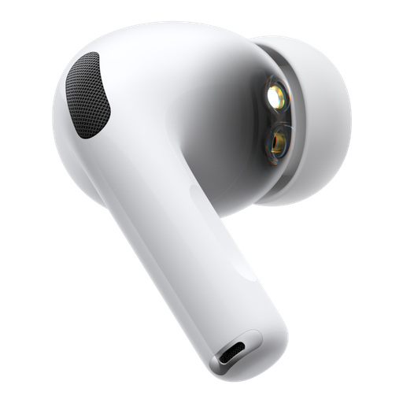
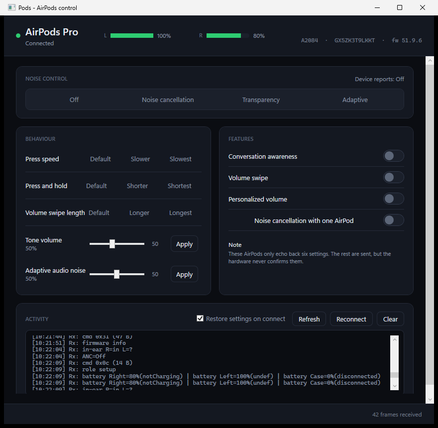

<div align="center">
  
  <h1>Pods</h1>
</div>

A free, open-source control app for Airoha-clone AirPods (AirPods Pro, AirPods Pro 2,
AirPods 3, …) on Windows 11.

No licence key, no account, no telemetry, no vendor servers. Just your buds.



---

## What it does

* **Noise control** — off / noise cancellation / transparency / adaptive
* **Conversation awareness**
* **Press speed** and **press-and-hold duration**
* **Volume swipe** and **volume swipe length**
* **Personalized volume**
* **Noise cancellation with one AirPod**
* **Tone volume** and **adaptive audio noise**
* Live **battery levels** for both buds and the case
* Live **device identity** (model, serial, firmware)
* Settings **persist** between launches and are restored on connect
* A **CLI** for scripting

---

## Requirements

| | |
|---|---|
| OS | Windows 11 (x64) |
| Runtime | .NET 8 Desktop Runtime |
| Hardware | Airoha-clone AirPods paired to the PC over classic Bluetooth |
| Driver | `MagicAAP.sys` — a Bluetooth transport driver |

### The driver

The AirPods' control channel is **Bluetooth L2CAP PSM 0x1001**, not GATT. Windows does
not let user-mode code open a raw L2CAP PSM, so a **kernel driver** is required.

Pods talks to an existing `MagicAAP` driver, which is a modified version of Microsoft's
public **BTHECHO** KMDF sample. If you already use
[MagicPods](https://magicpods.app), you already have it installed.

If you do not have it, see [docs/DRIVER.md](docs/DRIVER.md).

---

## Install

Download the latest release, or build it yourself:

```powershell
git clone https://github.com/<you>/Pods.git
cd Pods
dotnet build -c Release
dotnet run --project src/Pods.App
```

### Publish a single-file exe

```powershell
dotnet publish src/Pods.App -c Release -r win-x64 `
  -p:PublishSingleFile=true --self-contained false -o publish
```

---

## Usage

1. Close **MagicPods** (or any other AAP client). The driver hands the L2CAP channel to
   one client at a time — see [docs/PROTOCOL.md](docs/PROTOCOL.md).
2. Open **Pods**.
3. Put the AirPods in your ears. They must be actively connected, not idle in the case.

The window shows live battery, the device's confirmed settings, and an activity log.

### CLI

```powershell
pods-cli list                     # discover the driver interface
pods-cli read 120                 # dump inbound frames
pods-cli set anc 2                # turn noise cancellation on
pods-cli full 3                   # handshake, then set transparency
```

Run `pods-cli` with no arguments for the full list of settings.

---

## How it works

```
Pods (C#)  ->  \\?\BTHENUM#{...}#{9eec98bb-...}   (device interface)
          ->  CreateFile / WriteFile / ReadFile
          ->  MagicAAP.sys  (KMDF transport)
          ->  L2CAP PSM 0x1001
          ->  AirPods
```

A few things that are not obvious and cost a lot of time to find:

* **Device discovery is registry-based.** `SetupDiEnumDeviceInterfaces` does not see the
  interface. The path is read from
  `HKLM\SYSTEM\CurrentControlSet\Control\DeviceClasses\{9eec98bb-…}`, where the subkey
  name maps to the NT path by a single prefix swap (`##?#` → `\\?\`) and everything else
  is byte-identical. The interface GUID must be **lowercase**.
* **The driver's IO queue is synchronous and sequential.** A pending read owns the queue
  and blocks every later write. All writes must complete before a read is posted, and a
  write needs the pending read cancelled first — `CancelIoEx`, not
  `CancelSynchronousIo`, because the latter only cancels IO issued by the *calling*
  thread.
* **Settings need a warm-up.** A setting is only accepted after the startup sequence on
  the same connection, followed by a short settle delay.
* **Only six settings are readable back.** The rest are write-only — the AirPods never
  echo them. See [docs/PROTOCOL.md](docs/PROTOCOL.md#which-settings-are-reported).

Full details, including the driver reverse-engineering notes, are in
[docs/PROTOCOL.md](docs/PROTOCOL.md) and [docs/DRIVER.md](docs/DRIVER.md).

---

## Project layout

```
src/Pods.Core     protocol, transport, device session
src/Pods.App      WPF desktop app
src/Pods.Cli      command-line interface
tools/AapProbe    protocol debugger
tests/            unit tests for the protocol layer
docs/             protocol and driver notes
```

### Development

```powershell
dotnet build
dotnet test
dotnet run --project src/Pods.App
```

The protocol layer is fully covered by unit tests that run without any hardware
attached — packet layouts are asserted byte-for-byte against the reference
implementation, and the frame decoders are tested against captured byte sequences.

---

## Credits

* **[MagicPods](https://magicpods.app)** by Aleksandr Maslov — the original app this
  project is a free alternative to. No code from it is used here.
* **[MagicPodsCore](https://github.com/steam3d/MagicPodsCore)** by the same author — the
  open-source reference for the AAP packet formats, and the basis for every packet layout
  in this project.
* **Microsoft BTHECHO sample** — the `MagicAAP` driver is a derivative of it.
* The `UwpConnectionMessages` and Airoha command surfaces were recovered by decompiling
  the managed service with [de4dotEx](https://github.com/morluto/rea) and
  [Ghidra](https://ghidra-sre.org/).

## Licence

GPL-3.0. See [LICENSE](LICENSE).

This project is not affiliated with or endorsed by Apple Inc. or by the MagicPods author.
AirPods and MagicPods are trademarks of their respective owners.
